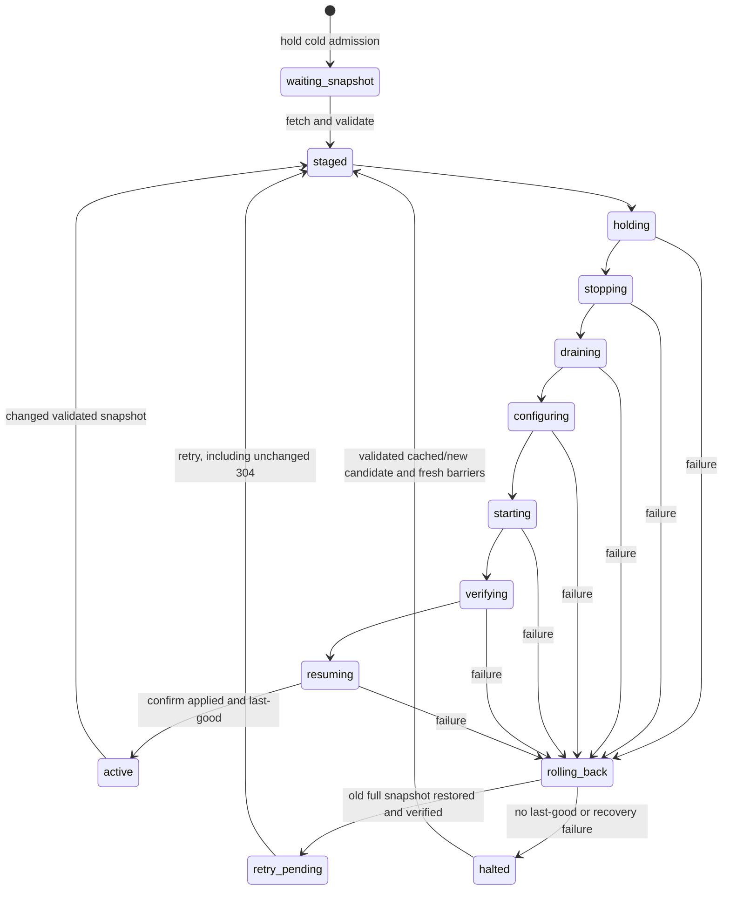

# RI clock provisioning: fetch, stage and coordinated apply

Nexus #201, based on Nexus `28fe5346396633f71b509275e9c7e9580504ff5b`
and RI `9083af2f851a38a442f90420e3cef913081c66a7`. RI ADR-0009/0010
remain Proposed. The static snapshot, run-free observation contract and single
BACnet connector/device scope from the previous stages are unchanged.

## Authentication and source selection

RI `GatewayConfigurationController.Get` implements
`GET /gateways/{gatewayId}/provisioning/v1`. Authorization precedes 304 handling:
the caller gateway identity, derived by the trusted mTLS ingress, must match the
path. An admin JWT is a separate diagnostic exception. A client cannot establish
identity by supplying `X-Gateway-Id` or forwarding-certificate headers itself.

`provisioning.NewClockHTTPClient` reuses the existing provisioning TLS factory
(`TLSOptions`: CA, client certificate/key, optional verified server name). The
new client requires HTTPS and a client certificate/key; it does not add trusted
headers or Authorization, disable certificate verification, or follow redirects.
This is a separate opt-in client. `cmd/gateway`, the old Point List API, CSV/file
bootstrap, URL selection and one-way fallback promotion are not modified.

The new API supports full snapshots only, never `since` or legacy deltas.
Defaults are 10 seconds per HTTP attempt, three attempts, 250 ms exponential
retry delay capped at two seconds. The caller can cancel the operation. Only
transport/body-read failures, timeouts, HTTP 429 and 5xx are retried. Certificate
verification/redirect refusal, 403/404/409, malformed JSON, schema/scope/reference
errors and ETag mismatch are errors without immediate retry. Body size is capped
at 16 MiB. Polling may try again later after a permanent error is corrected.

A 200 must have an ETag equal to the independently verified content revision.
A 304 must answer a nonempty conditional revision and return that same ETag.
`StageClock` wraps `StageClockSnapshot` and owns immutable bytes/native/mapping
data; accessors return copies. All validation completes before configuration
changes. Canonical point IDs stay in Core's mapping and never enter native
connector configuration. Empty points/clocks arrays retain their JSON array form.

`clock-config` keeps the existing offline file mode and adds an explicit fetch
mode. The following is a usage example, not an executed deployment command:

```sh
go run ./cmd/clock-config --provisioning-url https://ri.example.com \
  --gateway-id GW-EXAMPLE --connector-id bacnet-example --device-id 1234 \
  --provisioning-ca /path/to/ca.pem \
  --provisioning-cert /path/to/gateway.pem \
  --provisioning-key /path/to/gateway-key.pem
```

Exactly one of `--snapshot` and `--provisioning-url` is required. Both modes
output staged native configuration (or a separate `--normalizer` mapping); they
never restart processes, update a live resolver, or claim an applied revision.

## Apply transaction and observable state

`clocksync.Controller` serializes fetch/stage/apply/rollback; a concurrent Sync
is refused. `Status()` remains readable during operations. Fetch and each apply
operation have a configurable deadline. Rollback gets an independent bounded
context even when the caller's apply was cancelled or timed out.

| Field | Meaning |
| --- | --- |
| `desired_revision` | Latest fully validated staged snapshot and conditional-fetch ETag |
| `applied_revision` | Confirmed running configuration; empty during switching, cold start or failed recovery |
| `last_good_revision` | Last complete snapshot successfully verified and resumed |
| `phase` / `last_error` | Current transition and most recent failure |

The controller retains full desired/last-good snapshots in memory. It does not
load an old disk revision and assert that it is running. A new process starts
uninitialized with no applied claim and holds admission before its first fetch.
Durable crash recovery for these snapshots is not implemented in this stage;
process restart requires refetch and a new complete verification/apply cycle.



1. **Hold:** acquire exclusive target admission/lifecycle ownership; close both
   telemetry and commands and finish active operations.
2. **Stop:** confirm every old publisher instance is stopped.
3. **Drain:** process old queued/prefetched/NAK work under the old mapping and
   confirm durable storage and ACK completion. Do not wait for RI uplink delivery;
   already stored frames are independent of the current mapping.
4. **Configure:** with the gate held and publisher stopped/drained, install the
   complete native bundle and replace the scoped Normalizer/control mapping.
5. **Start and verify:** start the candidate behind the closed gate; verify a
   revision receipt from the running connector, not just the intended env/file.
6. **Resume:** atomically release telemetry/control admission only after that
   verification. Only then set `applied_revision` and `last_good_revision`.

`ResolverRuntime` implements the barrier checks and actual `SyncedResolver`
replacement. Native process configuration is delegated to `BACnetLifecycle`;
transport-specific admission/durable drain is delegated to `Admission`. One
controller exclusively owns each runtime/resolver. This stage supports only a
dedicated scoped resolver; do not overwrite a shared multi-protocol resolver.

## Failure and retry

Fetch/validation failures leave the running coherent configuration alone. Cold
start remains held. After any apply failure, rollback holds admission again,
stops any partial candidate and drains its events using the still-installed
candidate mapping before touching the old mapping. It then restores the entire
last-good native bundle/mapping, starts it, verifies its runtime receipt and
resumes. This preserves old settings even when configuration installation or
startup only partially succeeded.

Successful rollback enters `retry_pending`: desired remains new, applied remains
old. The next conditional fetch uses desired's ETag. A 304 retries that candidate;
it is not an apply ACK. A fetch error also does not erase the pending candidate.
If rollback fails, admission stays held and applied is unknown; stop is attempted
again, last-good stays retained, and the controller reports `halted`. A stop error
does not prove that the process terminated. It must never be reported as running
the old revision simply because that revision remains cached.

Deletion/clock removal is a full snapshot with explicit empty clock/binding
arrays, applied through the same barriers. Rollback also restores a complete
snapshot. SQLite frames are never re-resolved, retimestamped or relabeled.
No run context, run ID, step ID or `valid` is introduced; clocked observations
continue to have `sim_run_status=absent`.

## Initial component boundary and subsequent Gateway adapters

The initial `e8fa5df` stage implemented the reusable HTTP client, controller and resolver runtime,
with real Normalizer/temporary SQLite and HTTP mock + fake connector lifecycle
tests. At that point it was **not wired into `cmd/gateway`'s live sync loop**.
That existing pipeline had no scoped admission gate, broker drain receipt,
paused-start/revision receipt or lifecycle lease spanning admin/watch/update.
The legacy `lifecycle.Manager.Restart` and connector health boolean cannot
stand in for those guarantees. The subsequent
[Gateway wiring and isolated runbook](clock-gateway-isolated.md) implements the
concrete adapters and explicit opt-in branch, including persisted session-bound
resolution, paused producer receipts and management exclusion. It also records
the concrete startup/shutdown/recovery procedure and validation boundaries.

An admission adapter must account for delayed publications and ACK-loss/replay:
no old raw event may subsequently be resolved against a new mapping. It needs a
broker-confirmed publish/ACK barrier (not a local empty queue or sleep), or
retained revision/sequence-bound resolution for late old work. Candidate output
must stay quarantined until the runtime receipt succeeds, including clockless
configurations. Drain must validate the event revision/session binding before
normalizing: mismatched output from an unverified instance must remain
quarantined rather than being interpreted with the expected candidate mapping.
No tests here claim a production NATS/Docker barrier exists.

Tests cover mTLS peer verification and absence of forged identity headers,
200/304, retries/timeouts/cancellation, protocol/validation rejection, immutable
staging, full apply ordering, old backlog before new mappings, partial starts,
every failing apply operation, wrong runtime receipt, rollback failure, cached
304 retry, clock removal, scope rejection, concurrent Sync refusal and unknown
cold applied state. Source is the pinned real Builder→RI snapshot; changed IDs
and clock addresses are generated only in test memory to exercise transitions.
The original fixture is unchanged.

Run the tests with no live services:

```sh
go test ./internal/provisioning ./internal/clocksync ./cmd/clock-config \
  ./internal/pointsync ./internal/normalizer ./internal/storeforward -count=1
```

HTTP tests use ephemeral localhost TLS listeners. SQLite files and CA/key files
are temporary test data. No Docker, live equipment, BOPTEST REST/advance, running
RI apply, other-repository writes, push or merge is performed.
